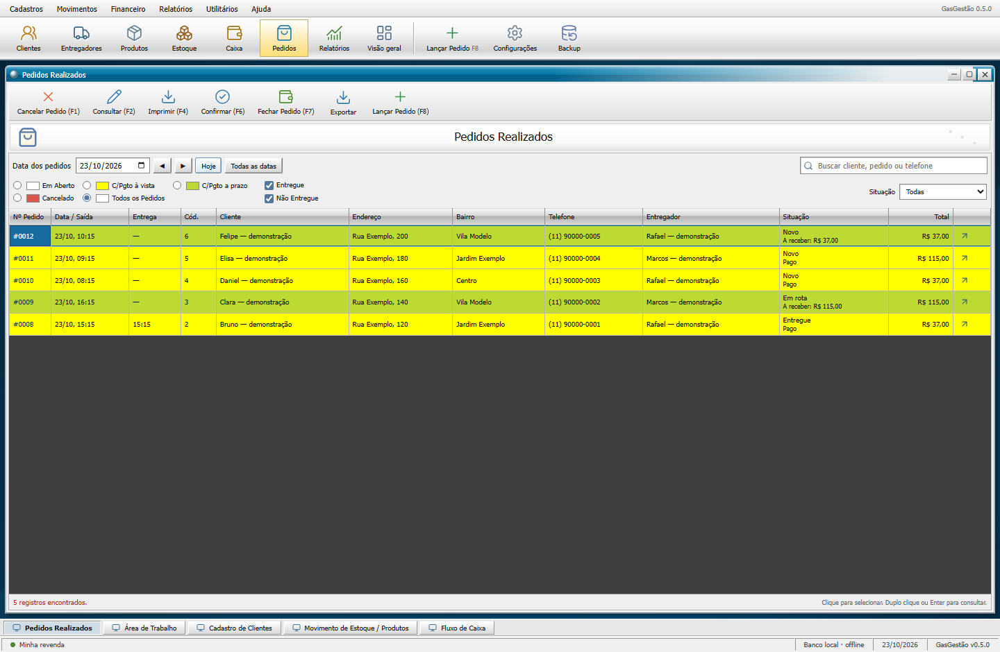
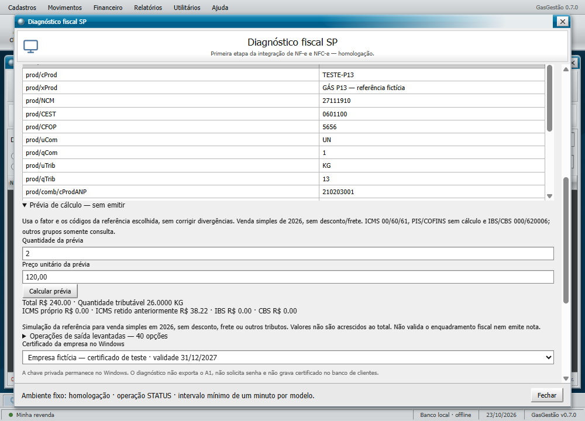

# GasGestão Desktop

Sistema Windows para organizar uma revenda de gás, água e entregas. Funciona offline e salva os dados em SQLite no computador.

**Versão 0.7.0.** Implementação nova com layout clássico inspirado nas referências públicas do GasExpert: menus superiores, barras de ferramentas, janelas internas, tabelas compactas e cores por pagamento. Código e elementos gráficos próprios. Não inclui executáveis, bancos, recursos visuais ou código descompilado do GasExpert. As regras foram implementadas para este projeto e precisam ser validadas com a operação real.

## Usar no Windows

O instalador fica em `release/GasGestao-0.7.0-Windows-x64-Setup.exe` após gerar a distribuição. Instalação por usuário, com opção de escolher a pasta e criar um atalho na área de trabalho. O instalador ainda não tem assinatura digital.

Também é possível abrir `release/win-unpacked/GasGestao.exe`, mantendo a pasta completa ao redor do executável. Não precisa instalar Node.js ou Java para usar o aplicativo empacotado.

Comece em **Clientes** e **Produtos**. Cadastre sua equipe em **Entregadores**, abra um **Novo pedido** e acompanhe a situação até a entrega. A base inicial vem vazia.

A opção **Explorar demonstração** aparece em **Visão geral** de uma base vazia. Ela cria dados fictícios e não apaga cadastros existentes. Os exemplos permanecem nessa base: use uma base separada para demonstração. Não existe botão de apagar a base neste MVP.

## O que funciona

- Cadastro e edição de clientes, produtos e entregadores, com ativação/inativação.
- Repetir pedido com revisão e preços atuais, sem cobrar ou reservar antes de confirmar.
- Lembretes de recompra por cliente/produto e mensagem editável para abrir manualmente no WhatsApp.
- Adiamento, pausa de lembretes e registro manual do contato por ciclo de compra.
- Controle de empréstimo e devolução de vasilhames por cliente e produto.
- CNPJ numérico/alfanumérico opcional, validado no cadastro e incluído no comprovante/CSV.
- Busca de clientes aceita texto colado com caracteres invisíveis e telefone/CNPJ formatados.
- Filtro de pedidos com pagamento pendente, inclusive após a entrega.
- Margem esquerda de comprovantes configurável e assinatura em vendas a prazo pendentes.
- Opção para exigir telefone no cadastro de clientes, desligada por padrão.
- Consulta offline de CEP no cadastro de clientes, com preenchimento de rua, bairro, cidade e UF.
- Pedidos com vários itens, entrega ou retirada, taxa de entrega e desconto.
- Fluxo de preparo, rota e entrega, com atribuição de entregador.
- Reserva de estoque na criação; reposição automática ao cancelar.
- Pagamentos integrais ou parciais, em dinheiro, Pix, débito ou crédito; pedidos a prazo.
- Cancelamento com registros de estorno por forma de pagamento e devolução de estoque.
- Entradas e saídas avulsas de estoque, com motivo e histórico.
- Caixa com recebimentos, despesas, estornos e saldo registrado.
- Relatórios por período e ranking de produtos.
- Comprovante de pedido pela impressão do Windows, sem emissão fiscal.
- Exportação CSV de clientes, produtos, pedidos e caixa.
- Backup completo manual e cópia automática diária ao reabrir um banco existente.
- Personalização do nome, telefone e endereço da revenda nos comprovantes.
- Diagnóstico real de conexão com NF-e (55) e NFC-e (65) em homologação de São Paulo, usando o certificado da empresa instalado no Windows.

O histórico da interface mostra os últimos 500 pedidos e 1.000 movimentações. A exportação de pedidos e caixa inclui o histórico completo. Os totais do painel e os relatórios consultam a base completa.



O aplicativo inicia em **Pedidos Realizados**. F8 abre um pedido, F9 retorna à consulta, e F2 salva os formulários. A consulta oferece filtros por data, pagamento e entrega. As referências oficiais usadas estão registradas em [Layout](docs/LAYOUT.md).

## Recompra, mensagens e vasilhames

As três ideias aprovadas estão disponíveis. Use **Clientes → ícone Repetir último pedido**, ou **Repetir pedido** nos detalhes; **Utilitários → Lembretes de recompra**; e **Movimentos → Vasilhames emprestados**.

As previsões começam com três compras concluídas do mesmo produto em dias diferentes e distinguem gás de água. O aplicativo prepara a mensagem, e você revisa e confirma o envio no WhatsApp. Não envia sozinho. Consulte [o guia com os cálculos e fluxos](docs/LEMBRETES-E-VASILHAMES.md).

## Melhorias comparadas com a edição 2026

O visual clássico foi preservado. O [levantamento](docs/COMPARATIVO-2026.md) registra as fontes oficiais, o que foi implementado e as diferenças que permanecem. CNPJ é opcional; as novas opções ficam em **Configurações → Opções de cadastro e impressão**. Validação de CNPJ é local e não consulta a situação cadastral da empresa.

## Referências fiscais de gás e água — 0.7.0

Em **Utilitários → Diagnóstico fiscal SP → Referências fiscais gás e água**, importe XMLs já emitidos, consulte os campos/códigos, vincule referências em revisão ao produto e calcule uma prévia sem criar venda ou transmitir nota. Foram levantadas 40 opções de saída. O catálogo real fica no banco local e no backup, fora do Git. Há alertas para códigos divergentes, conversão de unidades, embalagem/CEST e mudança de ST em SP. Consulte [os campos, resultados e limites](docs/FISCAL-GAS-AGUA.md).



## Integração fiscal — primeira etapa

Abra **Utilitários → Diagnóstico fiscal SP**, escolha o certificado da empresa e teste NF-e/NFC-e. Os dois serviços responderam **107 — Serviço em Operação** nos testes reais de 23/10/2026. A chave privada permaneceu no Windows; foram verificadas cadeia, revogação e conexão TLS, sem exportar o A1.

A tela de diagnóstico consulta o status em homologação; a versão 0.7.0 também permite ler XMLs já emitidos como referências privadas. A tela de vendas ainda não gera, assina ou emite nota, nem acessa produção. O retorno 107 não comprova credenciamento do emitente nem a correção de impostos. Comprovantes de pedido continuam sem valor fiscal. Consulte o [estudo de viabilidade, plano de 25 dias e revisão de segurança](docs/FISCAL-SP.md).

No laboratório de desenvolvimento, separado da tela de vendas, em 24/10/2026 foram autorizadas, consultadas e canceladas **duas NF-e fictícias de R$ 1,00: GLP e água tributada**. Oito XMLs dos modelos 55/65 passaram em assinatura A1 e XSD; NFC-e não foi transmitida nesta rodada. Isso não aprova a tributação real nem libera a emissão pela tela de pedidos. Resultados em [teste de gás e água](docs/TESTE-GLP-AGUA.md).

A NFC-e foi rejeitada anteriormente com 245, CNPJ emitente não cadastrado; o portal de testes exige dados do responsável para o credenciamento. Inutilização retornou 998, serviço desativado. Detalhes em [teste inicial de emissão](docs/TESTE-EMISSAO-SP.md).

## Busca offline de CEP

No cadastro de clientes, digite os oito dígitos do CEP, com ou sem hífen. A consulta começa automaticamente; **Buscar CEP** repete a busca. Havendo mais de um endereço, escolha uma das opções. Acrescente o número/complemento no campo Endereço e confira os dados antes de salvar. CEP e UF ficam gravados no cadastro e saem na exportação CSV.

Neste computador, a base local autorizada já foi convertida para `%LOCALAPPDATA%\GasGestao-Referencias\cep.sqlite`, com 1.131.462 endereços e integridade verificada. Cinco registros incompletos da origem foram descartados. A consulta não usa internet e funciona sem abrir o GasExpert.

Essa base fica separada dos dados de clientes, do código e do instalador. Em outro computador, é necessário instalar uma base local; sem ela, o preenchimento manual continua disponível. O backup operacional não inclui essa base de referência. A data de atualização dos CEPs da origem não foi confirmada; esta versão não faz atualização automática.

A ferramenta `scripts/import-cep.mjs` converte uma base MDB compatível em SQLite usando o provedor Jet de 32 bits do Windows, em modo somente leitura. Execute com Node 24 ou superior, passando os caminhos de origem e destino. Ela não sobrescreve um destino existente. Consulte [CEP offline](docs/CEP.md).

## Regras que protegem a operação

Dinheiro é armazenado em centavos inteiros. Pedidos, reserva de estoque, recebimentos e cancelamentos usam transações. O saldo não pode ficar negativo, e recebimentos não podem ultrapassar o valor do pedido. Concluir uma entrega não cria um pagamento automaticamente.

Cada item guarda o nome, preço e custo do momento do pedido. Alterações futuras no catálogo não reescrevem esses valores. Cancelar devolve o estoque e registra saídas de estorno no caixa; só confirme se as devoluções de produtos e valores serão realizadas.

O saldo do caixa representa todas as formas de pagamento registradas. Não é uma conciliação bancária nem apenas o dinheiro físico na gaveta.

## Dados e backups

Os dados ficam em `%APPDATA%/GasGestao/gasgestao.sqlite`. A tela **Configurações** mostra o caminho efetivo. A pasta `backups` no mesmo diretório recebe as cópias automáticas. Guarde backups adicionais em outro disco.

O aplicativo é local e destinado a um usuário do Windows por vez. Compartilhamento simultâneo do banco em rede, controle de usuários e restauração por uma tela do aplicativo ainda não estão implementados. Não há importação automática dos bancos protegidos do GasExpert.

## Desenvolver

Requisitos: Node.js 24 e npm, Windows x64 para os testes desktop e a distribuição Windows.

```powershell
npm ci
npm run dev
```

Compilar e verificar:

```powershell
npm test
npm run build
npm run test:ui
npm run test:engagement
npm run test:fiscal
node scripts/test-fiscal-references-ui.mjs
```

Gerar a pasta executável ou o instalador:

```powershell
npm run pack
npm run dist
```

Os testes de interface usam diretórios separados em `.test-artifacts`; eles não usam o banco pessoal. A variável `GASGESTAO_DATA_DIR` permite escolher uma base isolada em desenvolvimento. Não a aponte para os arquivos originais do GasExpert.

`test:fiscal` usa respostas simuladas identificadas. Para a verificação real de status, use `node scripts/test-fiscal-ui.mjs --live`; acrescente `--packaged` para testar a distribuição já gerada. Essa opção acessa os dois serviços de homologação com o certificado instalado, sem emitir documentos. O teste automático real exige exatamente um certificado de empresa elegível; a tela permite escolha manual.

### Organização

```text
electron/    Processo desktop, banco, regras transacionais e impressão
src/         Interface React + TypeScript em português
tests/       Testes de estoque, pedidos, caixa, backup e comprovantes
scripts/     Desenvolvimento, teste de interface e geração de ícone
assets/      Identidade visual original
docs/        Roteiro e registros de validação
```

O renderer usa isolamento de contexto e sandbox. Somente operações específicas passam pelo preload; SQL, arquivos e Node.js ficam no processo principal. A interface não carrega páginas ou scripts externos.

## Desenvolvimento e GitHub

O código próprio e a documentação estão em [peterson1dhon/gasgestao](https://github.com/peterson1dhon/gasgestao). O repositório criado pelo usuário é público. Bancos, backups, XMLs fiscais, certificados, credenciais, instaladores e arquivos do sistema original ficam fora da publicação.

A inspeção autenticada do RevGás está no [estudo funcional](docs/ESTUDO-REVGAS.md), com diferenças, limites de acesso e prioridades propostas. O layout clássico permanece preservado.

Veja [o roteiro](docs/ROTEIRO.md), [o histórico](CHANGELOG.md) e [a validação](docs/VALIDACAO.md).

Referências técnicas usadas: [Electron IPC](https://www.electronjs.org/docs/latest/tutorial/ipc), [isolamento de contexto](https://www.electronjs.org/docs/latest/tutorial/context-isolation), [SQLite no Node.js](https://nodejs.org/docs/latest-v24.x/api/sqlite.html).
