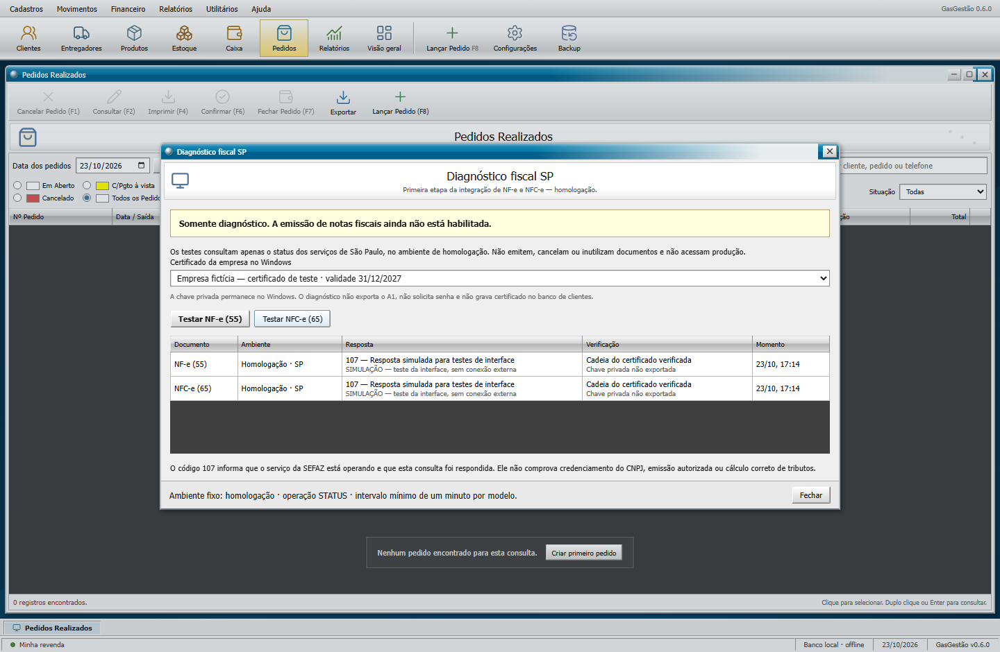

# NF-e e NFC-e de São Paulo — viabilidade e segurança

> Atualização 24/10/2026: o plano atual de implementação fiscal está no [dossiê para GPT Sol](fiscal/LEIA-PRIMEIRO-SOL.md). Este documento preserva o histórico; conferir vigências e estado atual no dossiê.

Registro de 23/10/2026, versão 0.6.0. Objetivo: permitir emissão pelo aplicativo Windows, preservando o layout clássico e a operação local. O usuário informou certificado A1 e interesse nos modelos 55 e 65.

**Atualização posterior ao diagnóstico:** o laboratório de desenvolvimento já autorizou e cancelou uma NF-e fictícia em homologação. NFC-e retornou 245 e inutilização 998; existem pendências. O instalador 0.6.0 e sua tela de vendas continuam com diagnóstico somente. O [relatório de emissão](TESTE-EMISSAO-SP.md) descreve o resultado mais recente.

## Resultado concreto desta etapa

A conectividade direta com os dois serviços de homologação é viável neste computador. O aplicativo utilizou o certificado da empresa já instalado no repositório pessoal do Windows. Os testes reais retornaram:

| Modelo | Operação | Ambiente | Resposta |
| --- | --- | --- | --- |
| NF-e 55 | STATUS | Homologação SP, `tpAmb=2`, `cUF=35` | 107 — Serviço em Operação |
| NFC-e 65 | STATUS | Homologação SP, `tpAmb=2`, `cUF=35` | 107 — Serviço em Operação |

Foram testados o processo auxiliar, os canais do aplicativo, a tela, a persistência após reinício e o executável empacotado. Evidências públicas mínimas, sem identificação do certificado ou dados de clientes, em [resultado-sefaz.json](resultado-sefaz.json).

O retorno 107 confirma que a consulta foi respondida pelo serviço. Não confirma que o estabelecimento está credenciado para emitir, que uma nota seria autorizada ou que os tributos estão corretos. Na etapa inicial de diagnóstico, nenhuma nota foi emitida, cancelada ou inutilizada. A etapa posterior do laboratório está registrada no relatório acima. Nenhum webservice fiscal de produção foi acessado. A integração de emissão ainda não está pronta para substituir o RevGás.

Na versão 0.6.0, **Utilitários → Diagnóstico fiscal SP** permite repetir somente essas consultas. Os destinos são fixos. O intervalo mínimo é de um minuto por modelo durante a execução do aplicativo. Resultados anteriores mostram a data da consulta; não são monitoramento contínuo da disponibilidade da SEFAZ.

## O que depende da empresa

O laboratório posterior ao diagnóstico conferiu empresa/certificado e consultou o cadastro oficial, que retornou inscrição ativa e regime normal de apuração. O ciclo da NF-e foi aceito em homologação; a NFC-e ainda depende do credenciamento de testes. Antes do uso diário, o cadastro fiscal completo e endereço atual devem ser revisados com a empresa. A consulta de status não fez esse credenciamento.

O cadastro fiscal dos produtos precisa incluir NCM, unidade e os enquadramentos aplicáveis à operação: CFOP, CST/CSOSN, classificação e parâmetros de combustíveis/ANP para GLP e demais campos exigidos. Não há alíquotas ou códigos fiscais presumidos no programa. O contador precisa conferir essa parametrização, inclusive os campos e regras da reforma tributária que incidirem na operação.

Um XML autorizado recente do RevGás para cada modelo ajuda a identificar o tratamento atualmente utilizado. Esses arquivos contêm dados fiscais e pessoais: devem ficar em pasta privada, fora do Git e das capturas públicas. Depois do diagnóstico inicial, foram localizados XMLs antigos do emissor local, lidos para referência fora do repositório. O regime neles estava desatualizado e não foi adotado sem consultar o cadastro atual. Certificado, senha e CSC não devem ser enviados pelo chat nem adicionados ao código. O laboratório gera QR Code v3 online, validado estruturalmente; a autorização/consulta pública da NFC-e ainda está pendente. Caso outra versão aplicável exija CSC, sua configuração terá de usar armazenamento protegido e ambiente correto.

## Sequência para a janela de 25 dias

O prazo informado pelo usuário foi tratado como janela de planejamento. Contando 25 dias a partir de 23/10/2026, a referência é 17/11/2026; a data exata do vencimento do sistema atual não foi verificada. O cronograma abaixo é uma estimativa de trabalho e depende dos dados fiscais e dos resultados de cada etapa.

| Período | Entrega e critério de avanço |
| --- | --- |
| Dias 1–3 | Estudo, conexão real com os dois serviços, revisão inicial de segurança. Conectividade concluída; falta conferir o credenciamento e o cadastro fiscal da empresa. |
| Dias 4–8 | Gerar XML dos dois modelos com dados de teste, assinar pelo Windows e validar contra o pacote XSD oficial vigente. Conferir tributos e GLP com os exemplos/contador. |
| Dias 9–14 | Obter autorização de documentos em homologação, guardar XML e protocolo, interpretar rejeições e consultar resultado após falha/tempo limite. Impedir envio duplicado e separar numeração por estabelecimento, modelo, série e ambiente. |
| Dias 15–19 | Testar cancelamento, inutilização quando cabível, indisponibilidade/contingência, recuperação após reinício e DANFE/QR Code conforme os manuais vigentes. Verificar protocolo com o tamanho atual, sem pressupor 15 posições. |
| Dias 20–23 | Regressão de pedidos, estoque e caixa; conferência com contador; impressão no equipamento da operação; cópia e recuperação de XMLs e configurações fiscais protegidas. |
| Dias 24–25 | Avaliar os resultados e pendências. Só preparar uso em produção quando autorização, recuperação, numeração, impressão e tratamento fiscal estiverem comprovados. |

Um recebimento de pedido e uma autorização fiscal são operações diferentes: o desenho da integração deve preservar estoque/caixa e registrar o estado fiscal sem marcar nota como emitida antes do protocolo. Falha de rede exige consulta/recuperação do resultado, sem repetir cegamente a autorização. Numeração fiscal não pode ser reaproveitada como se fosse um pedido apagável.

Esta etapa não introduz envio automático, emissor incompleto ou botão que pareça emitir. A viabilidade confirmada é da conexão autenticada; a viabilidade do fluxo completo será comprovada com os marcos acima.

## Segurança verificada

- Certificado lido do repositório `CurrentUser/My`, aberto somente para leitura. A chave privada foi utilizada pelo TLS do Windows e não foi exportada. Não houve leitura de arquivo PFX, solicitação de senha ou gravação da chave no banco.
- Cadeia validada com verificação de revogação online, sem ignorar erros de confiança; conexão TLS 1.2 com validação normal do servidor e verificação de revogação. Não foi desativada a validação de certificados.
- No diagnóstico distribuído, os únicos destinos são os dois serviços de status de homologação. O chamador não fornece URL, comando, ambiente ou XML livre. Redirecionamentos HTTP são recusados. O laboratório posterior acrescenta destinos fixos de homologação para cadastro, autorização, consulta, cancelamento e inutilização, com guardas próprios descritos no relatório de emissão.
- Processo auxiliar com argumentos separados, sem shell interpolado, sem janela e com tempo limite. A alteração de política de execução vale apenas para esse processo; nenhuma política permanente do Windows foi modificada.
- Resposta XML limitada em tamanho, DTD proibido e resolução externa desativada. Modelo, ambiente, UF, operação e destino são conferidos antes de aceitar o resultado.
- Renderer com sandbox, isolamento de contexto, Node desabilitado e canais específicos de IPC com verificação de origem. Navegação, novas janelas e permissões da página permanecem bloqueadas.
- Registro `fiscal-status.json` fora do código, contendo somente resultados limitados; leitura com limite de tamanho e lista de campos permitidos. Não guarda senha, chave, seletor de certificado ou dados de cliente. O registro local não é prova criptográfica nem substitui XML/protocolo fiscal.
- Auditoria `npm audit` em 23/10/2026: zero vulnerabilidades conhecidas reportadas na árvore instalada. Testes verificam rejeição de parâmetros indevidos, ocultação de erros sensíveis e separação de dados operacionais.

Há limites materiais: o instalador ainda não tem assinatura de código; SQLite operacional e backups não têm criptografia própria; acesso depende da proteção da conta e do disco Windows. A revisão não foi um teste de invasão e não comprova segurança total do computador. Armazenamento protegido de segredos fiscais, recuperação completa e distribuição assinada continuam como pendências antes da operação fiscal final.

## Fontes oficiais e atualização

Os destinos utilizados foram conferidos nas páginas da SEFAZ/SP de [NF-e](https://portal.fazenda.sp.gov.br/servicos/nfe/Paginas/URL-WEBSERVICES.aspx) e [NFC-e](https://portal.fazenda.sp.gov.br/servicos/nfce/Paginas/WebServices.aspx). A separação entre credenciamento e teste de conexão consta das [orientações de credenciamento NF-e](https://portal.fazenda.sp.gov.br/servicos/nfe/Paginas/PaginaGuiaDoUsuario.aspx). O [portal NFC-e/SP](https://portal.fazenda.sp.gov.br/servicos/nfce/) publica orientações de credenciamento, CSC e mudanças no autorizador.

A emissão deverá usar os manuais, notas técnicas e esquemas do [Portal Nacional NF-e](https://www.nfe.fazenda.gov.br/portal/principal.aspx). A NT 2025.002 e suas revisões de 2026 são relevantes para IBS/CBS e combustíveis; a identificação de versões pelas listagens não substitui baixar, conferir e fixar o pacote de implementação. A listagem apresentou redirecionamento na consulta inicial. No laboratório posterior, o download oficial foi concluído com sessão HTTP e o pacote 010f foi utilizado na validação dos documentos. Manifesto e arquivos estão fora do repositório. Novas versões/datas de ativação continuam exigindo acompanhamento antes de operar em produção.
